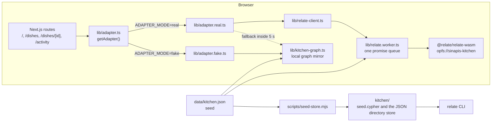

# Sinapis

Sinapis is an allergen graph for a restaurant kitchen: it shows which sauce and which supplier product put each allergen on each dish. When a supplier changes a recipe, it lists every affected dish with its path before the chef accepts the change, because one quiet spec change in a nested sauce is how allergen mistakes reach a plate.

**Live demo: https://sinapis-nine.vercel.app** Start on the overview (DEMO.md step 1), then click "Log supplier change" in the rail (steps 3 and 4).

## Try it in 60 seconds

1. Open https://sinapis-nine.vercel.app. The overview shows the allergen load chart and the matrix: 16 dishes by the 14 EU allergens for Meyhane Lodos. Switch the chart between "Per allergen" and "Cumulative".
2. Click the Grilled sea bass by Mustard cell. The path reads Grilled sea bass > Green herb sauce > Ready-made mayonnaise > Catering mayonnaise, 5 L (Metro Wholesale Kadıköy) > Mustard.
3. Click "Log supplier change" in the rail. Pick "Stone-ground tahini, 2 kg tin", "Peanuts", "May contain", then "Preview impact". Seven dishes are listed, each with its sauce path.
4. Click "Apply to the kitchen graph", go back to the overview, and see the Peanuts column turn red in 7 cells.
5. Click the Lamb shish by Peanuts cell. The path graph draws the chain left to right; hover or tab to a node and the sentence under the graph reads it back.

Open `/?reset=1` to return the browser to the seed. The full walk, with the guest check, is in `DEMO.md`.

## Addresses

| What | Address |
| --- | --- |
| Live web app | https://sinapis-nine.vercel.app |

## The problem

EU kitchens must declare 14 allergens on every dish. The dish is rarely where it goes wrong. The mistakes hide in nested sub-recipes: a green herb sauce made with ready-made mayonnaise, and mustard inside that mayonnaise. The supplier switches a production line, sends a one-line email saying the tahini "may now contain peanuts", and somebody has to work out which dishes that touches.

An independent chef with an Excel allergen matrix does that by rereading every recipe card. The spreadsheet holds an X in a cell and nothing about why it is there, so a quiet spec change is the most predictable failure in the whole system.

## The solution

Sinapis models the kitchen as a graph:

```
(:Dish)-[:USES]->(:SubRecipe)-[:USES]->(:Ingredient)-[:SUPPLIED_AS]->(:SupplierProduct)-[:CONTAINS|MAY_CONTAIN]->(:Allergen)
                                                                     (:SupplierProduct)-[:SUPPLIED_BY]->(:Supplier)
```

Every flag in the matrix is a path returned by a variable-length Cypher query. Click a cell and you see the chain behind it.

Three things a chef can do on day one:

1. **Read the matrix.** 16 dishes by 14 allergens for Meyhane Lodos, a small meyhane in Istanbul. Contains, may contain and unknown get different colors.
2. **Log a supplier change.** Pick the product, the allergen and the new declaration. Sinapis walks the graph backwards from that product, lists every dish it reaches with the path, and writes to the graph only after the chef confirms. The changed cells light up in the matrix.
3. **Answer a guest.** On the Dishes page, pick the guest's allergens (sesame and celery, say). You get the dishes that are clear, and the dishes that would be clear if the kitchen swapped one sauce ("Roasted cauliflower: garlic yogurt sauce instead of tahini lemon sauce").

A product with no spec sheet on file is **unknown**, never **free**, and that state travels along every path it sits on. Sinapis is decision support, not a medical guarantee.

## Architecture



The matrix on `/` and the API routes under `app/api/` always answer from the mirror. The path list, the impact preview, the write and the guest check answer from Relate when `ADAPTER_MODE=real`.

## How it uses Relate

Relate is the engine that answers. If you remove the relationships, no cell in the matrix can be computed.

| Question | Graph pattern | Where |
| --- | --- | --- |
| Why does this dish carry this allergen? | forward variable-length path, Dish to Allergen | `CYPHER.dishAllergenPaths` in `lib/relate.ts` |
| Which dishes break if this product changes? | reverse traversal from one SupplierProduct | `CYPHER.productImpact` |
| Which dishes are safe for this guest? | no CONTAINS, MAY_CONTAIN or unknown-spec path to the guest's allergen codes | `CYPHER.guestSafeDishes`, asked by `guestCheck` in `lib/adapter.real.ts` |
| What becomes safe if one sauce is swapped? | every offending path runs through one substitutable node, and the replacement reaches no offending product | `CYPHER.guestSwap` (the substitution list comes from `data/kitchen.json` as the `$swaps` parameter) |
| Accept the supplier's change | delete and merge one relationship, then read back the reached dishes | `CYPHER.clearDeclaration`, `addContains` or `addMayContain`, then `productReach`, sent in one worker round by `applyChange` in `lib/adapter.real.ts` |

### Which Relate mode, and why

We use **two modes on purpose**:

- **Directory store with the JSON codec** (`./kitchen/store`). Judges can open the persistent store without running the web app, and because the codec is JSON a change in the seed shows up as a readable git diff. `npm run seed` writes `kitchen/seed.cypher` from `data/kitchen.json` and builds the store when the `relate` CLI is on PATH (the proof block below says whether this build did).
- **WebAssembly in the browser with OPFS persistence** (`opfs://sinapis-kitchen`). The live demo needs no server and no API key. The chef's accepted changes survive a reload, and a judge opening the link runs the same engine we do.

In-memory mode is not used for the store. It would leave nothing for a judge to inspect.

With `ADAPTER_MODE=real`, the browser starts one dedicated module worker (`lib/relate.worker.ts`) that loads `@relate/relate-wasm`, runs its `init()`, opens `opfs://sinapis-kitchen` with `RelateDb.open` and seeds it from `data/kitchen.json` when the seed marker is missing. Every statement goes through `db.execute(query, paramsJson)` inside one promise queue, because the WASM build rejects re-entrant calls. If the worker cannot load or does not answer, the same question is answered by `lib/kitchen-graph.ts`, a local mirror of the same patterns.

**What the live URL runs.** Every answer carries a note in the UI. "Live engine: Relate (WASM, stored in this browser with OPFS)." means Relate answered. "Sample data: answered by the local graph mirror, not by Relate." means the mirror answered, which is always the case for the overview matrix and is the case for every answer when the deployment runs with the default `ADAPTER_MODE=fake`.

Five-second rule: opening the worker (module download, OPFS open, first seed) has 3 s; one query attempt has 2 s, with exactly one retry, and the whole call is capped at 4.8 s. A worker that fails to open stays off for the session and every later question goes straight to the mirror.

### Reset and persistence

The only state that changes during the demo is the list of supplier changes applied in this browser: `localStorage` key `sinapis.applied.v1` (read and written only by `lib/store.ts`) and, in real mode, the Relate OPFS store. The server holds no state, so there is no migration and no schema push. Press "Reset to seed" on the overview (shown after a local change) or open `/?reset=1` to clear both.

### Three queries to paste into `relate` against ./kitchen

```cypher
// 1. Why is the sea bass flagged for mustard?
MATCH p = (d:Dish {id: "grilled-sea-bass"})-[:USES*1..6]->(:Ingredient)-[:SUPPLIED_AS]->(sp:SupplierProduct)-[:CONTAINS]->(:Allergen {code: "MUS"})
RETURN [n IN nodes(p) | coalesce(n.name, n.code)] AS path;

// 2. Which dishes does the tahini tin reach?
MATCH p = (d:Dish)-[:USES*1..6]->(:Ingredient)-[:SUPPLIED_AS]->(:SupplierProduct {id: "p-tahini"})
RETURN d.name AS dish, [n IN nodes(p) | n.name] AS via ORDER BY dish;

// 3. Which dishes depend on a product with no spec sheet?
MATCH (d:Dish)-[:USES*1..6]->(:Ingredient)-[:SUPPLIED_AS]->(sp:SupplierProduct {specKnown: false})
RETURN DISTINCT d.name AS dish, sp.name AS unknownProduct;
```

To expose the same store to an agent over MCP, run `relate serve --mcp --database kitchen/store` (check the subcommand against `relate --help` for your version).

## Prize tracks

This hackathon has no sponsor bounty. All three tracks are main placements, entered automatically, and each one rests on the same Relate code.

| Bounty | Prize | Slots | Required tech | Code file | DEMO step |
| --- | --- | --- | --- | --- | --- |
| First place | Mac Studio (M5 Max, 64GB / 1TB) valued at $3,799 | 1 | Relate | `lib/adapter.real.ts` (engine calls through `lib/relate.worker.ts`) | 4, 5, 6 |
| Second place | Mac mini (M6, 32GB / 512GB) valued at $1,499 | 1 | Relate | `lib/adapter.real.ts` (engine calls through `lib/relate.worker.ts`) | 4, 5, 6 |
| Third place | Mac mini (M6, 16GB / 256GB) valued at $899 | 1 | Relate | `lib/adapter.real.ts` (engine calls through `lib/relate.worker.ts`) | 4, 5, 6 |

Deleting `lib/adapter.real.ts` and `lib/relate.worker.ts` breaks DEMO steps 2, 4 and 6, because no mirror-free answer remains. Submission steps per track are in `DELIVERY.md`.

## Tech stack

- Next.js 15 (App Router), React 19, TypeScript strict, Tailwind CSS 4, shadcn-style primitives (Radix Slot, class-variance-authority, clsx, tailwind-merge, lucide-react)
- Relate by Neo4j: `@relate/relate-wasm` 1.2 in a dedicated browser worker with OPFS persistence, `relate` CLI for the directory store
- Cypher 25 (variable-length paths)
- d3 7 (scales, stack, cumulative sum, line and link shapes; no DOM work) and Motion 14 for the allergen load chart, its per-allergen and cumulative switch, and the path graph
- zod 3 for input validation at the API edge
- tsx and `node:test` for the tests
- Vercel, no API keys, Relate runs in the browser; API routes answer from the local mirror

## Quickstart

```bash
npm install
npm run dev          # http://localhost:3000, works with zero env vars
npm test             # pinned kitchen facts and input schemas (node:test through tsx)
npm run proof        # runs the tests, the seed and the Relate queries, and rewrites the proof blocks below
npm run demo:reset   # rebuilds the seed (and kitchen/store if relate is on PATH), prints the reset URL and the walk
```

To run the browser path on Relate instead of the local mirror, copy `.env.example` to `.env.local` and set `ADAPTER_MODE=real`.

## Proof from the last build

`npm run proof` writes these lines from what it actually ran. A line that starts with "Not run in this build" means the check could not run, and says why.

- Tests:
<!-- PROOF:BEGIN tests -->
`npm test` on 2026-11-24: 17 passed, 0 failed, exit 0, 0.7 s.
<!-- PROOF:END tests -->
- Relate engine:
<!-- PROOF:BEGIN relate-engine -->
`CYPHER.productImpact` for `p-tahini` on @relate/relate-wasm 1.2.0 in Node, in-memory store seeded with 187 statements, on 2026-11-24: 8 rows, 7 distinct dishes, 14.3 ms.
<!-- PROOF:END relate-engine -->
- Guest check on Relate (Sesame plus Celery):
<!-- PROOF:BEGIN guest -->
`CYPHER.guestSafeDishes` and `CYPHER.guestSwap` for Sesame plus Celery on @relate/relate-wasm 1.2.0 in Node, in-memory store seeded with 187 statements, on 2026-11-24: 3 safe dishes (cacik, grilled-sea-bass, zucchini-fritters), 3 safe with one swap (baba-ghanoush, fried-calamari, roast-cauliflower), roasted cauliflower with the garlic yogurt sauce swap: yes, 27.6 ms.
<!-- PROOF:END guest -->
- Seed store:
<!-- PROOF:BEGIN seed-store -->
`node scripts/seed-store.mjs` on 2026-11-24: wrote kitchen/seed.cypher with 187 statements for 16 dishes. kitchen/store built: no (seed: store not built, the relate CLI is not on PATH (ENOENT).).
<!-- PROOF:END seed-store -->

## Seed data

`data/kitchen.json` holds 16 dishes, 10 sub-recipes, 22 supplier products from 6 suppliers and the 14 EU allergens. Allergen declarations follow the kind of statements printed on real catering labels (mayonnaise with egg and mustard, stock powder with celery, tahini with sesame). Suppliers and dish names are realistic but invented for the demo. One product (loose pul biber) has no spec sheet, so it shows the "unknown" path.

## What we would build next

- Import a supplier spec sheet PDF and propose the graph change for the chef to confirm.
- A printable allergen card per dish, with the path printed beside each flag for the inspector.
- Several sites sharing one supplier graph, so a change at one supplier warns every kitchen that uses it.

## Declarations

- **Relate capabilities used:** embedded WASM engine with OPFS persistence, directory store with the JSON codec, CLI, variable-length Cypher paths, write transactions.
- **Third-party tools:** Next.js, React, Tailwind CSS, d3, Motion, zod, Radix Slot, lucide-react, class-variance-authority, tailwind-merge, clsx, and tsx for the tests. All open source. No code written before 11 November 2026.
- **License:** the repository has no LICENSE file yet.

## AI use

The hackathon rules allow AI tools: the participant is responsible for the result, for its originality and for its license fit, and significant use must be disclosed. We disclose it here: we used AI coding assistants for scaffolding, boilerplate, the interface pass and the documentation drafts. Architecture, product decisions and final review are our own.

Sinapis is decision support, not a medical guarantee.
